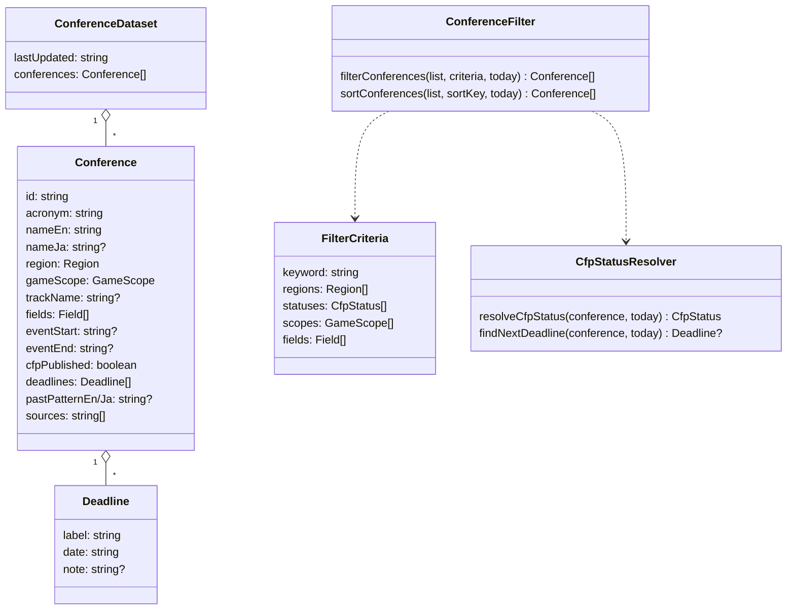
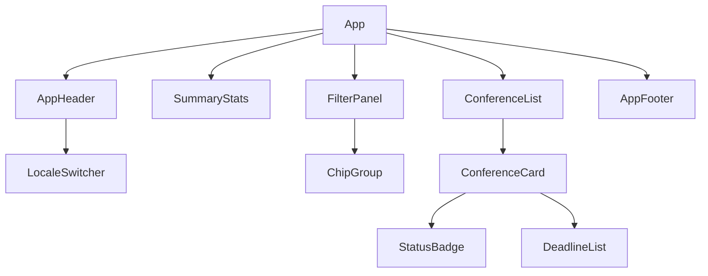
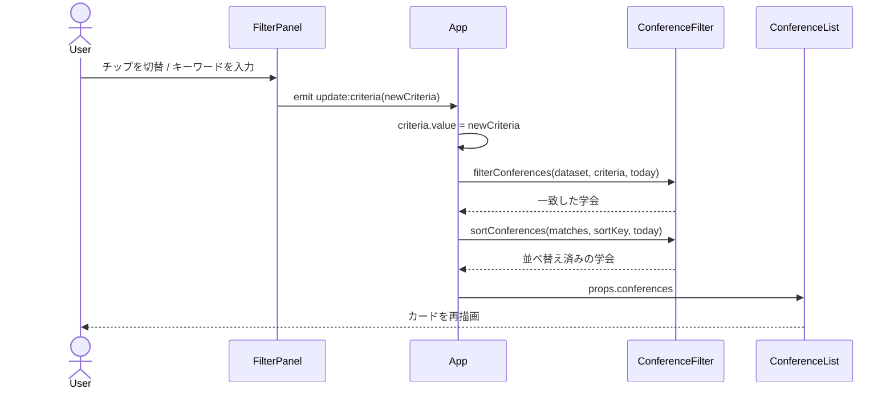

# アーキテクチャ

[English version](Architecture.md)

本サイトは Vite でビルドする、クライアントのみで動作する Vue 3 シングルページアプリケーションです。データセットはビルド時に同梱される JSON ファイルのため、バックエンドはなく、`dist/` の出力をそのまま GitHub Pages で配信できます。

## ディレクトリ構成

```
src/
├── Main.ts                 エントリポイント: i18n とグローバル CSS を伴って App をマウント
├── App.vue                 ルート: フィルタ・並び順の状態を保持し、ページを構成
├── I18n.ts                 vue-i18n インスタンス、ロケールの保存、Intl ロケール変換
├── Components/             表示用 SFC (それぞれ単一責務)
├── Services/               純粋な TypeScript ロジック (Vue 非依存)
├── Types/                  ドメイン型 (Conference, Deadline, Field, CfpStatus)
├── Locales/                En.ts (主) と Ja.ts の UI メッセージ
├── Data/Conferences.json   データセット
└── Styles/Global.css       デザイントークン (ライト/ダーク) と基本スタイル
Tests/                      Vitest 単体テスト (データセット検証を含む)
.github/workflows/          GitHub Pages デプロイ
```

## レイヤ

- **Types** はデータ契約 (`Conference`, `Deadline`, `Field`, `CfpStatus`) を定義します。
- **Services** はそれらの型に対する純粋関数で、単体テストの対象です。
  - `ConferenceRepository`: 同梱データセットを読み込みます。
  - `ConferenceValidator`: 全レコードを検査します (テストから呼ばれるため、不正データは CI で失敗します)。
  - `CfpStatusResolver`: 基準日に対する `open` / `closed` / `unknown` と次の締切を求めます。
  - `ConferenceFilter`: キーワード・地域・状況・ゲームの扱い・分野で絞り込み、並べ替えます。
  - `DateUtility`: ISO 日付とロケールに応じた書式化を扱います。
- **Components** は props を描画しイベントを emit するだけで、状態の所有者は `App.vue` のみです。

## クラス図



## コンポーネントツリー



## シーケンス: 一覧の絞り込み



## 状況の判定規則

| 条件                                      | 状況      |
| ----------------------------------------- | --------- |
| `cfpPublished` が false、または締切がない | `unknown` |
| 本日以降の締切が1つ以上ある               | `open`    |
| すべての締切が本日より前                  | `closed`  |

「本日」は閲覧者のローカル日付のため、サイトを再ビルドしなくても状況が更新されます。

## 多言語化

既定は英語で、日本語を選ぶと `localStorage` に記憶されます。日本語 UI では日本語名 (`nameJa`) があればそれを表示します。備考と前回実績は、片方の言語が欠けている場合はもう一方にフォールバックします。
