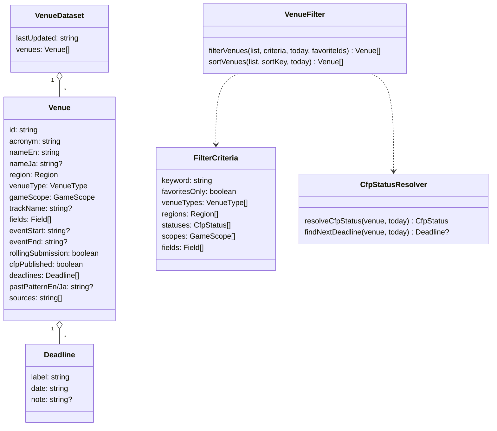
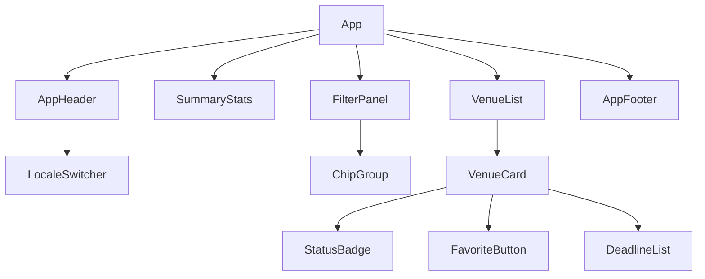
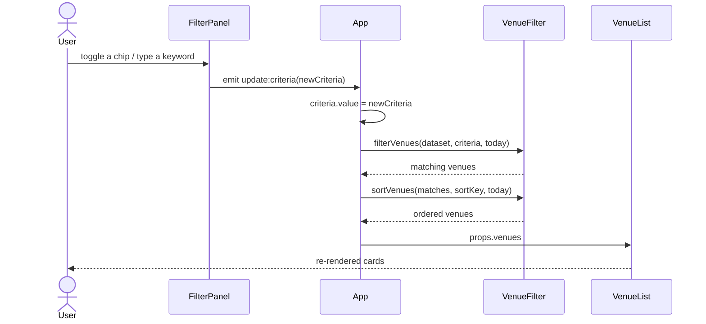

# Architecture

[日本語版](Architecture.ja.md)

A **venue** is either a 2027 conference edition or a journal (including a game special issue of a general journal). The site is a client-only Vue 3 single-page application built with Vite. The dataset is a JSON file bundled at build time, so there is no backend and the output in `dist/` can be hosted on GitHub Pages as-is.

## Directory layout

```
src/
├── Main.ts                 Entry point: mounts App with i18n and global CSS
├── App.vue                 Root: owns filter/sort state, composes the page
├── I18n.ts                 vue-i18n instance, locale persistence, Intl locale mapping
├── Components/             Presentational SFCs (one responsibility each)
├── Services/               Pure TypeScript logic (no Vue dependency)
├── Types/                  Domain types (Venue, Deadline, Field, CfpStatus)
├── Locales/                En.ts (primary) and Ja.ts UI messages
├── Data/Venues.json        The dataset
└── Styles/Global.css       Design tokens (light/dark) and base styles
Tests/                      Vitest unit tests, including dataset validation
Scripts/                    Data-update issue body builder (run with tsx)
.github/workflows/          GitHub Pages deployment and the bimonthly update issue
```

## Layers

- **Types** define the data contract (`Venue`, `Deadline`, `Field`, `CfpStatus`).
- **Services** are pure functions over those types and are unit tested:
  - `VenueRepository` loads the bundled dataset.
  - `VenueValidator` checks every record (used by tests, so bad data fails CI).
  - `CfpStatusResolver` derives `open` / `rolling` / `unknown` / `closed` and the next deadline for a reference date.
  - `VenueFilter` filters by keyword, venue type, region, status, game scope and fields, and sorts.
  - `DateUtility` handles ISO dates and locale-aware formatting.
  - `FavoriteCookie` stores and reads favourite venue ids in a cookie.
- **Components** only render props and emit events; `App.vue` is the single owner of state.

## Class diagram



## Component tree



## Sequence: filtering the list



## Status rules

Rules are evaluated top to bottom:

| Condition                                                    | Status    |
| ------------------------------------------------------------ | --------- |
| `cfpPublished` and at least one deadline is on/after today   | `open`    |
| `rollingSubmission` (journals accepting submissions anytime) | `rolling` |
| `cfpPublished` is false or there are no deadlines            | `unknown` |
| every deadline is before today                               | `closed`  |

Sorting by "next deadline" lists `open` venues by date, then `rolling`, `closed` and `unknown`.

"Today" is the viewer's local date, so statuses update without rebuilding the site.

## Favorites

`App.vue` owns the set of favourite ids and updates it on `toggle-favorite` events from the ★ `FavoriteButton` in each `VenueCard`. Every change is written by `FavoriteCookie` to the `game-related-cfps-favorites` cookie (path = site base path, one-year max age, SameSite=Lax), which is read back on start-up. With "Favorites only" on, `filterVenues` keeps only ids in the set.

## Update reminder

`Scripts/UpdateIssueBuilder.ts` reuses `CfpStatusResolver` to group venues into re-check checklists. `.github/workflows/DataUpdateIssue.yml` runs `pnpm issue-body` every two months and opens an issue with that output, assigned to konbraphat51.

## Localization

English is the default locale; Japanese is selectable and remembered in `localStorage`. Venue names use `nameJa` when the Japanese UI is active and a Japanese name exists. Notes and past-edition hints fall back to the other language when one is missing.
