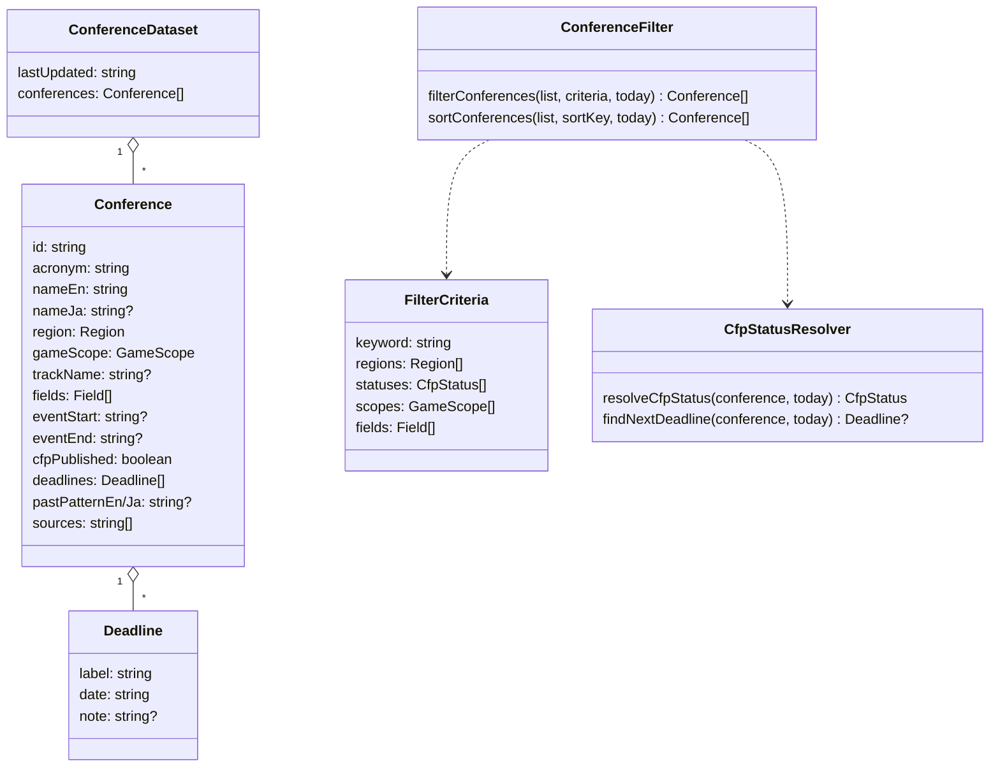
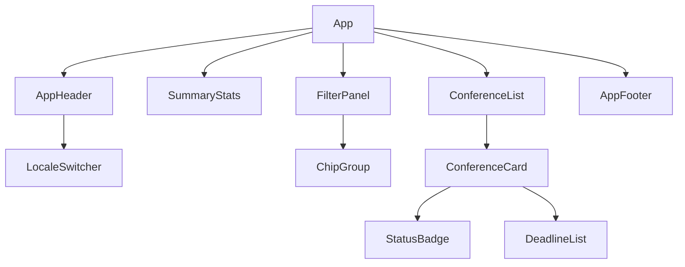
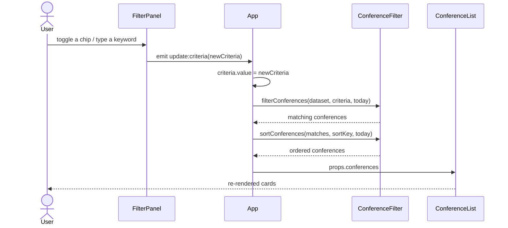

# Architecture

[日本語版](Architecture.ja.md)

The site is a client-only Vue 3 single-page application built with Vite. The dataset is a JSON file bundled at build time, so there is no backend and the output in `dist/` can be hosted on GitHub Pages as-is.

## Directory layout

```
src/
├── Main.ts                 Entry point: mounts App with i18n and global CSS
├── App.vue                 Root: owns filter/sort state, composes the page
├── I18n.ts                 vue-i18n instance, locale persistence, Intl locale mapping
├── Components/             Presentational SFCs (one responsibility each)
├── Services/               Pure TypeScript logic (no Vue dependency)
├── Types/                  Domain types (Conference, Deadline, Field, CfpStatus)
├── Locales/                En.ts (primary) and Ja.ts UI messages
├── Data/Conferences.json   The dataset
└── Styles/Global.css       Design tokens (light/dark) and base styles
Tests/                      Vitest unit tests, including dataset validation
.github/workflows/          GitHub Pages deployment
```

## Layers

- **Types** define the data contract (`Conference`, `Deadline`, `Field`, `CfpStatus`).
- **Services** are pure functions over those types and are unit tested:
  - `ConferenceRepository` loads the bundled dataset.
  - `ConferenceValidator` checks every record (used by tests, so bad data fails CI).
  - `CfpStatusResolver` derives `open` / `closed` / `unknown` and the next deadline for a reference date.
  - `ConferenceFilter` filters by keyword, region, status, game scope and fields, and sorts.
  - `DateUtility` handles ISO dates and locale-aware formatting.
- **Components** only render props and emit events; `App.vue` is the single owner of state.

## Class diagram



## Component tree



## Sequence: filtering the list



## Status rules

| Condition                               | Status    |
| --------------------------------------- | --------- |
| `cfpPublished` is false or no deadlines | `unknown` |
| at least one deadline is on/after today | `open`    |
| every deadline is before today          | `closed`  |

"Today" is the viewer's local date, so statuses update without rebuilding the site.

## Localization

English is the default locale; Japanese is selectable and remembered in `localStorage`. Conference names use `nameJa` when the Japanese UI is active and a Japanese name exists. Notes and past-edition hints fall back to the other language when one is missing.
